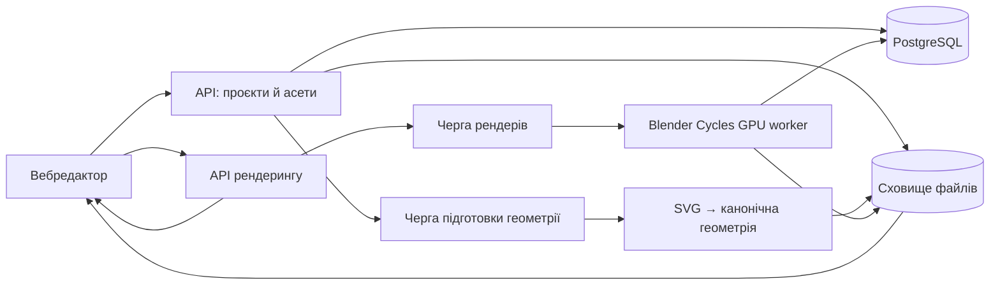

# SVG → 3D: архітектура застосунку

Статус: запропонована специфікація для розробки MVP. Дата: 4 жовтня 2026 року.

Деталізація v0.1: [MVP_SPEC.md](MVP_SPEC.md), [SCENE_SPEC.md](SCENE_SPEC.md), [RENDER_SPEC.md](RENDER_SPEC.md), [API_SPEC.md](API_SPEC.md), [AGENTS.md](AGENTS.md). Ці документи уточнюють альтернативи огляду: у v0.1 stroke і перекриття частин відхиляються, некоректна фаска не зменшується автоматично, сцена має фіксований масштаб і перспективну камеру. За розбіжностей детальні контракти мають пріоритет. Реалізація та перевірка прототипом ще попереду.

## 1. Продукт і базові рішення

Вебзастосунок перетворює плоскі SVG-форми та логотипи на об’ємні об’єкти, дає змогу налаштувати композицію й експортувати якісне зображення. SVG визначає силует, а об’єм створюється витягуванням контуру вздовж осі Z з фасками. Це не автоматична реконструкція довільного тривимірного предмета з малюнка.

Для MVP приймаємо такі рішення:

- Один SVG-асет на сцену; він може містити багато окремих форм і отворів.
- Увесь об’єкт обертається як група; матеріал можна призначити всьому об’єкту або окремій формі.
- Матеріали: скло, метал, хром. Хром — окремий користувацький пресет металу.
- Стиль є набором параметрів геометрії, матеріалів, освітлення, фону й камери; після застосування його можна редагувати.
- Браузер забезпечує інтерактивний перегляд; серверний GPU-рендер забезпечує фінальну якість.
- JPG і PNG, п’ять співвідношень сторін; анімація — наступна версія.
- AI-генерація зображення не потрібна: геометрію та ракурс визначає 3D-сцена.

## 2. Користувацький сценарій

1. Завантажити SVG або відкрити демонстраційний приклад.
2. Побачити результат перевірки: підтримувані форми, попередження, елементи, які потрібно виправити.
3. Отримати початковий об’єм із безпечною глибиною та фаскою.
4. Вибрати стиль: наприклад, прозоре скло, матовий метал, полірований хром.
5. Налаштувати колір, глибину, фаску, текстуру, світло та фон.
6. Обертати об’єкт, змінювати масштаб і кадрування; вибрати пропорції кадру.
7. За потреби отримати контрольний рендер меншої роздільності тим самим рушієм, що й фінальний.
8. Запустити 4К-рендер, побачити стан черги та завантажити результат.

Проєкт автоматично зберігається; доступні undo/redo та повернення до вихідного стилю. Зміна налаштувань після запуску рендера не змінює вже запущене завдання.

## 3. Компоненти системи

Рекомендована структура для старту — модульний бекенд і окремі фонові воркери. Мікросервіси для кожної функції на етапі MVP не потрібні.

| Компонент | Відповідальність | Запропонована технологія |
|---|---|---|
| Вебредактор | Інтерфейс, сцена, маніпуляції, локальна історія | React + TypeScript + Three.js |
| Стан редактора | Параметри сцени, undo/redo, автозбереження | Zustand або аналогічне сховище |
| API | Доступ, проєкти, асети, валідація, рендер-завдання | Node.js + TypeScript, Fastify |
| Геометричний воркер | Нормалізація SVG, побудова й перевірка mesh | TypeScript, SVGLoader як частина конвеєра |
| Рендер-воркер | Побудова фінальної сцени, рендер, кодування | Python + Blender Cycles |
| Черги | Повторні спроби, пріоритет, обмеження паралельності | Redis + BullMQ |
| База | Власники, проєкти, ревізії, завдання, пресети | PostgreSQL |
| Файли | SVG, mesh, HDRI, текстури, прев’ю, результати | S3-сумісне об’єктне сховище |

Версії бібліотек і Blender потрібно зафіксувати після технічного прототипу; потужність GPU визначити за вимірюваннями на тестових сценах.

## 4. Імпорт SVG та побудова об’єму

Конвеєр: upload → перевірка → очищення → нормалізація → контури → перевірка топології → витягування → фаски → mesh → прев’ю.

### Підтримка першої версії

- Замкнуті `path`, `rect`, `circle`, `ellipse`, `polygon`, вкладені групи й трансформації.
- Отвори всередині форм із коректним урахуванням правил заливки `evenodd` / `nonzero`.
- Кілька незалежних форм з окремими ідентифікаторами й початковими кольорами.
- Прості обводки — тільки після перевіреного перетворення stroke на замкнуту площину; якщо цей конвертер не готовий, імпорт просить перевести обводки в контури.
- Текст потрібно попередньо перетворити на криві.

Маски, clipPath, фільтри, градієнти, вбудовані растрові картинки та відкриті контури не отримують мовчазної приблизної інтерпретації. MVP показує конкретне пояснення й просить спрощений SVG. Підтримку цих можливостей можна додавати окремо.

### Нормалізація

Розгорнути трансформації, застосувати viewBox, узгодити напрямок осі Y, знайти межі видимого об’єкта та зберегти початкові пропорції. Центрувати геометрію відносно стабільного pivot. Максимальний розмір у площині XY прийняти за 1 одиницю сцени; фізичний масштаб зберігати окремо, наприклад 0,1 метра на одиницю. Масштаб потрібен для узгодженого поглинання світла в склі.

### Геометрія

Побудувати зовнішні контури та отвори, дискретизувати криві з контрольованою похибкою, виконати тріангуляцію, додати бічні грані та фаски. Для замкнутого об’єкта перевірити нормалі, нульові площі, відкриті ребра й самоперетини.

Радіус фаски обмежується не лише глибиною, а й локальною шириною деталей. Якщо фаска руйнує тонкий фрагмент, зменшити її з попередженням або повернути помилку, яку користувач може виправити. SVGLoader / ExtrudeGeometry — корисна основа, але не повний розв’язок надійних булевих операцій і складних фасок.

Перекриття форм потребують явної політики: підтримуване злиття геометрії або відхилення проблемного SVG. Не залишати взаємопроникні скляні оболонки як прихований результат імпорту. Надійність цього етапу перевіряється першою в технічному прототипі.

Після зміни глибини чи фаски клієнт показує швидкий попередній результат, а воркер готує перевірену версію. Фінальний рендер використовує лише завершений geometry revision. Колір, світло й поворот не перебудовують mesh.

## 5. Модель проєкту та сцени

Джерело істини — версіонований опис сцени, незалежний від об’єктів Three.js або Blender. Бінарна геометрія й текстури лежать окремо; сцена містить посилання та контрольні суми.

| Сутність | Основні поля |
|---|---|
| Project | id, ownerId, title, currentRevisionId, timestamps |
| Asset | id, ownerId, sourceKey, sanitizedKey, sourceHash, importStatus, warnings |
| GeometryRevision | id, assetId, generatorVersion, parameters, meshKey, meshHash, status |
| SceneRevision | id, projectId, schemaVersion, sceneSnapshot, contentHash |
| SceneObject | id, geometryRevisionId, transform, partMaterialAssignments |
| Material | id, model, baseColor, roughness, metalness, transmission, ior, absorption, textureRefs |
| StylePreset | id, version, geometryDefaults, materials, lightRig, background, cameraDefaults |
| RenderJob | id, ownerId, sceneRevisionId, rendererVersion, settings, status, progress, attempts, errorCode |
| RenderArtifact | id, jobId, storageKey, width, height, mimeType, checksum, expiresAt |

Трансформація об’єкта: position, quaternion, scale. Камера: тип, position, target, focalLength або orthographicScale, clipping planes. Світло: тип, position, rotation, color, intensity, dimensions. У контракті потрібно зафіксувати систему координат, одиниці довжини, світлових параметрів і колірний простір.

Окремі частини SVG мають стабільні ідентифікатори: зміна глибини не повинна втрачати призначення матеріалів. Проєкт зберігає застосовану версію пресета та фактичні параметри, тому оновлення бібліотеки стилів не змінює старі роботи.

## 6. Матеріали, колір і текстури

| Матеріал | Поведінка | Налаштування користувача |
|---|---|---|
| Скло | Передавання, заломлення й поглинання світла | Відтінок, матовість, IOR, насиченість поглинання |
| Метал | Металеві відбиття з різною шорсткістю | Колір, roughness, масштаб текстури |
| Хром | Полірований метал із виразним оточенням у відбиттях | Roughness, нейтральний або художній відтінок |

Для скла недостатньо зменшити opacity: потрібні замкнута геометрія з реальною товщиною, transmission, IOR та поглинання залежно від довжини шляху променя. Для металу й хрому критично важливе оточення, яке відбивається.

Текстури MVP — підготовлена бібліотека roughness і normal maps: гладка, дрібна шорсткість, brushed metal. Використовувати стабільні UV або узгоджене тріпланарне відображення. Фіксувати масштаб, орієнтацію та seed процедурних текстур; не прив’язувати текстуру до камери. Власні текстури користувача — окреме розширення.

Колір із UI зберігати з позначеним простором sRGB, обчислення освітлення виконувати в лінійному просторі. Карти roughness і normal трактувати як дані, а не колірні зображення.

## 7. Освітлення та фон

Початкова студійна схема: велике основне area light, слабше заповнення, контрове джерело й HDRI для оточення. Користувач може змінювати положення, розмір, інтенсивність і температуру джерел; простий режим може керувати всім світловим набором одним поворотом.

Фізичний результат залежить від нормалей поверхні, матеріалу, товщини, джерел, оточення й камери. Для фінального зображення використовується path tracing. Кількість відскоків, adaptive sampling, denoise та обробку каустик слід налаштувати на тестовому наборі. Не обіцяти ідеальні каустики або фіксований час рендера без перевірки.

Автоматичний градієнтний фон:

1. Взяти колір об’єкта або колір головної форми багатоколірного логотипа.
2. Зберегти той самий hue, зменшити lightness для нижньої частини та трохи підняти її для верхньої частини градієнта.
3. Скоригувати saturation і lightness для виразного силуету, привести колір до доступного gamut.
4. Для майже нейтрального хрому або безбарвного скла використати стабільний studio tint: їхній вигляд визначається оточенням, а не лише baseColor.
5. Не давати окремого ручного color picker для фону у MVP; збережений background.color залишається похідним від кольору об’єкта.

Градієнт одного відтінку не гарантує читабельність. Для скла важливі контрове світло, крайові відбиття та різниця тону позаду силуету. Візуальний фон і світлове оточення — різні параметри сцени, навіть якщо користувач керує ними одним кольором.

## 8. Камера і композиція

- Перетягування обертає об’єкт навколо pivot; окремий режим керує камерою. Операції не слід змішувати неявно.
- Доступні zoom, зміщення композиції, reset view і fit to frame.
- Початково використовувати перспективну камеру з помірною перспективою; ортографічну можна додати для більш графічної подачі.
- Рамка експорту завжди видима; зміна пропорцій змінює кадр, а не розтягує об’єкт.
- Автовписування залишає початковий відступ приблизно 10%; ручне кадрування може виходити за межі.
- Прев’ю і фінальний рендер використовують однакові camera transform та aspect ratio.

## 9. Два режими рендерингу

**Інтерактивний:** Three.js із PBR-матеріалами, environment lighting та адаптивною якістю. Під час руху можна знижувати роздільність і якість тіней. Ціль — комфортна взаємодія на узгоджених тестових пристроях, без обіцянки універсальних 60 FPS.

**Фінальний:** ізольований Blender Cycles worker на GPU. Він завантажує перевірену геометрію, відновлює сцену з JSON, рендерить у заданому розмірі й записує результат у сховище.

Растрове браузерне прев’ю та Cycles не будуть піксельно ідентичними. Для надійного узгодження потрібні однакові mesh, камера, джерела й HDRI, адаптери матеріалів, зафіксоване управління кольором та контрольні сцени. Перед 4К-експортом пропонується контрольний Cycles-рендер меншого розміру.

Геометрію слід генерувати один раз і передавати обом рушіям, наприклад через GLB для mesh. Не покладатися на GLB як на повний опис матеріалів, світла та налаштувань рендера: їх передає власний контракт сцени. Перетворення координат Three.js ↔ Blender має бути явним і перевіреним.

## 10. Експорт у 4К

Термін «4К» для нестандартних пропорцій неоднозначний. Продуктова домовленість MVP: довга сторона 3840 px, із показом точного розміру в UI.

| Пропорція | Розмір |
|---|---|
| 16:9 | 3840 × 2160 |
| 9:16 | 2160 × 3840 |
| 4:3 | 3840 × 2880 |
| 3:4 | 2880 × 3840 |
| 1:1 | 3840 × 3840 |

Це запропонована домовленість, а не універсальний стандарт 4К для кожної пропорції.

JPG: непрозорий фон, sRGB, налаштування якості. PNG: sRGB, фон або alpha. Фінал обчислюється у потрібній роздільності, а не збільшується з прев’ю. Ліміт ресурсів залежить від кількості пікселів, тому квадратний експорт дорожчий за 16:9.

Прозоре скло на прозорому PNG не може зберегти фізично правильне заломлення будь-якого майбутнього фону: звичайний RGBA не містить такої інформації. Для скла основний рекомендований результат — з обраним фоном; transparent PNG слід описати як композиційний варіант з обмеженнями. Оточення для відбиттів залишається навіть при прихованому фоні камери.

## 11. API та життєвий цикл завдань

| Метод і шлях | Призначення |
|---|---|
| POST /assets/uploads | Отримати дозвіл на завантаження файлу |
| POST /assets/:id/prepare | Перевірити завантаження й поставити імпорт у чергу |
| GET /assets/:id | Стан імпорту та діагностика |
| POST /geometry-revisions | Підготувати геометрію для параметрів об’єму |
| GET /geometry-revisions/:id | Стан і посилання на геометрію |
| POST /projects | Створити проєкт |
| GET /projects/:id | Завантажити проєкт |
| POST /projects/:id/revisions | Зберегти нову ревізію з перевіркою baseRevision |
| GET /styles | Каталог версіонованих стилів |
| POST /renders | Запустити preview або final для конкретної ревізії |
| GET /renders/:id | Стан, етап, помилка, готові файли |
| POST /renders/:id/cancel | Запросити скасування |
| GET /renders/:id/download | Отримати короткочасне посилання на результат |

Оновлення стану — polling для MVP; SSE можна додати без зміни моделі завдань.

Стани: queued → preparing → rendering → encoding → completed. Додаткові: failed, cancel_requested, canceled. Скасування має припиняти роботу воркера, а не тільки змінювати напис в інтерфейсі. Відсоток показувати тільки там, де його можна виміряти; позиція в черзі не є прогнозом часу.

POST /renders використовує idempotency key. Завдання отримує незмінний snapshot сцени, параметрів експорту й версії рушія. Воркери мають heartbeat, lease, timeout і обмежені повторні спроби; детерміновані помилки геометрії не повторюються автоматично. Публікація артефакту має бути ідемпотентною.

## 12. Надійність, доступ і ресурси

- SVG не вставляється як довірений HTML: вилучити скрипти, обробники подій, foreignObject і зовнішні посилання; заборонити DTD та зовнішні сутності.
- Перевіряти доступ до кожного project, asset, render і artifact за власником. Не довіряти переданим користувачем шляхам або довільним URL ресурсів.
- Обмежувати розмір SVG, кількість вузлів і контурів, деталізацію кривих, полігони, пам’ять та тривалість роботи.
- Запропоновані стартові обмеження для прототипу: SVG до 5 МБ, фінальний mesh до 1 млн трикутників, одне активне GPU-завдання на користувача. Переглянути після вимірювань.
- Запускати воркери в ізольованому середовищі без довільного мережевого доступу й без виконання скриптів із завантажених файлів.
- Кешувати геометрію за hash джерела, параметрів і версії генератора; рендер — за повним snapshot, асетами, рушієм і налаштуваннями. Доступ до кешованого результату все одно перевіряється.
- Зберігати структуровані помилки: invalid_svg, unsupported_feature, invalid_geometry, resource_limit, render_failed.
- Вимірювати тривалість імпорту, час черги, GPU-секунди, пікову пам’ять і частоту помилок. Вартість одного експорту визначати за цими даними.
- Політику зберігання оригіналів і результатів задати до запуску; показувати користувачу термін доступності файлу. Резервне копіювання БД та очищення сирітських файлів виконувати окремими задачами.

## 13. Основа для майбутньої анімації

Зараз відділити сцену від часу й передбачити необов’язкову timeline: duration, fps, tracks, keyframes, interpolation. Перші анімації: turntable, рух камери та поворот світлового набору.

Треки посилаються на стабільні objectId / lightId. Обертання інтерполюються кватерніонами. Номер кадру детерміновано задає час і стан сцени. Завдання анімації складається з діапазонів кадрів із можливістю повторного рендера лише невдалих ділянок, а потім окремого кодування відео.

MP4 — базовий кандидат для відео; формат із alpha потрібно вибрати окремо за вимогами до сумісності. До запуску анімації потрібні окремі тести мерехтіння denoise, motion blur, пам’яті, часу й вартості 4К-послідовностей.

## 14. План реалізації

1. **Технічний прототип.** SVG із отворами, тонкими деталями та перекриттями; скло й хром у Cycles; спільний mesh; зіставлення камери й кольору між рушіями. Результат — виміряні обмеження і приклади фінальної якості.
2. **Редактор.** Імпорт, три матеріали, початкова бібліотека текстур і стилів, глибина, фаски, поворот, кадрування, світло, фон, undo/redo.
3. **Збереження та експорт.** Проєкти, ревізії, GPU-черга, контрольне прев’ю, усі пропорції, JPG/PNG, скасування й відновлення після збоїв.
4. **Підготовка запуску.** Тести SVG-конвеєра, візуальна перевірка, квоти, спостережуваність, облік GPU-витрат.
5. **Анімація.** Timeline, кадри, кодування, завантаження відео.

## 15. Критерії приймання MVP

- Тестові логотипи з отворами, кількома формами й тонкими деталями зберігають силует; непідтримувані SVG дають зрозумілу помилку.
- Геометрія скла замкнута, нормалі коректні, фаски не створюють самоперетинів у підтримуваних випадках.
- Зміна ракурсу та світла змінює відбиття; скло показує залежні від товщини заломлення й поглинання на контрольних сценах.
- Усі п’ять пропорцій експортуються в обумовлені розміри; об’єкт не розтягується, JPG не містить alpha.
- Збереження й повторне відкриття відновлюють композицію; старий render job завжди відповідає своїй ревізії.
- Контрольний і фінальний Cycles-рендери зберігають матеріали, світло та композицію з очікуваними відмінностями деталізації й шуму.
- Збій воркера, повторний запит і скасування не створюють неконтрольованих дублікатів роботи або недоступних «готових» результатів.
- Перевірені доступ до чужих файлів, обробка небезпечного SVG та ресурсні обмеження.

## 16. Джерела для технічних рішень

- Three.js SVGLoader: https://threejs.org/docs/pages/SVGLoader.html
- Three.js MeshPhysicalMaterial: https://threejs.org/docs/pages/MeshPhysicalMaterial.html
- Blender Cycles: https://www.blender.org/features/rendering/
- Cycles renderer source: https://github.com/blender/cycles

Документація підтверджує можливості базових інструментів. Конкретний конвеєр, модель даних, розміри експорту та межі MVP вище — запропоновані архітектурні рішення, які слід перевірити прототипом.
