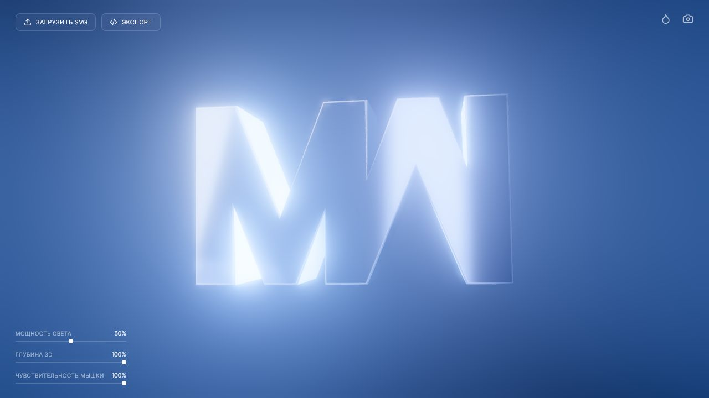
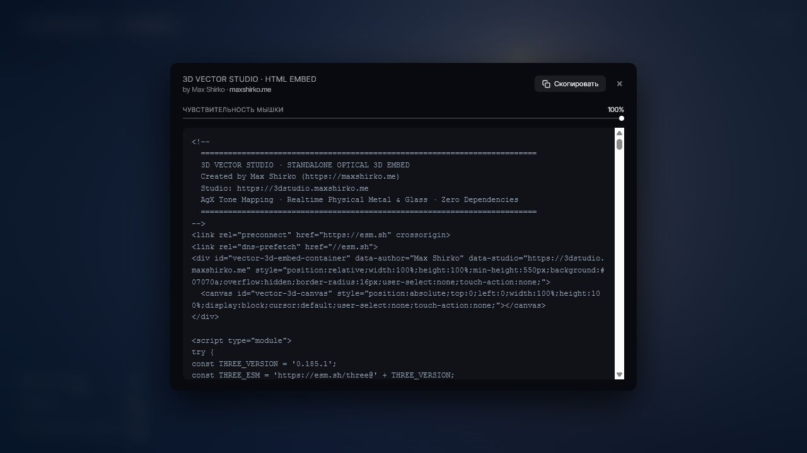
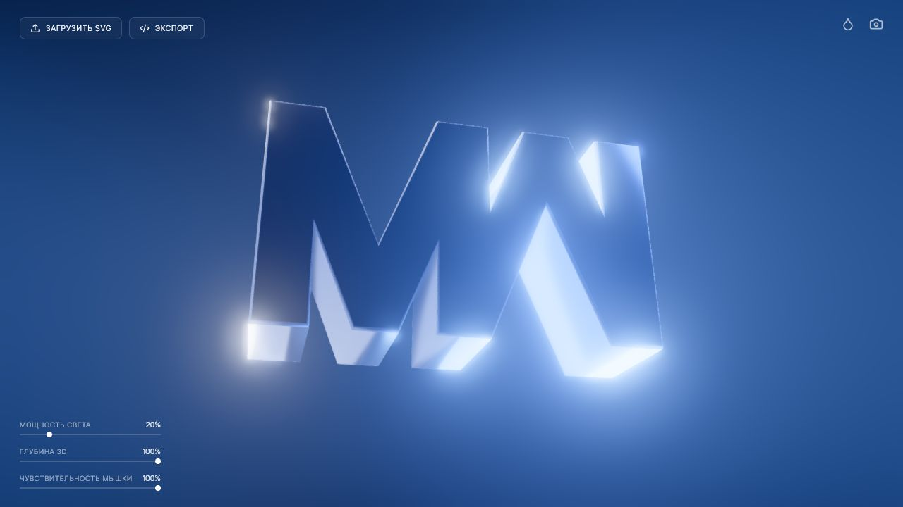
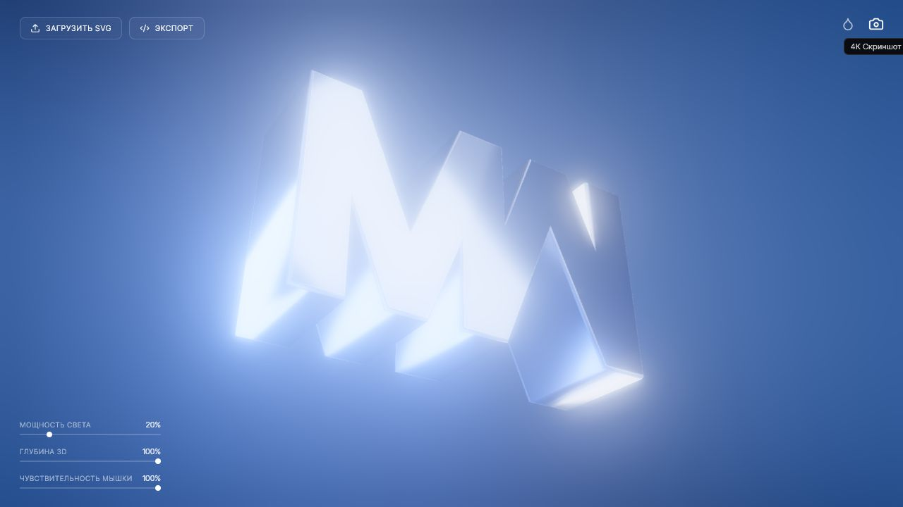
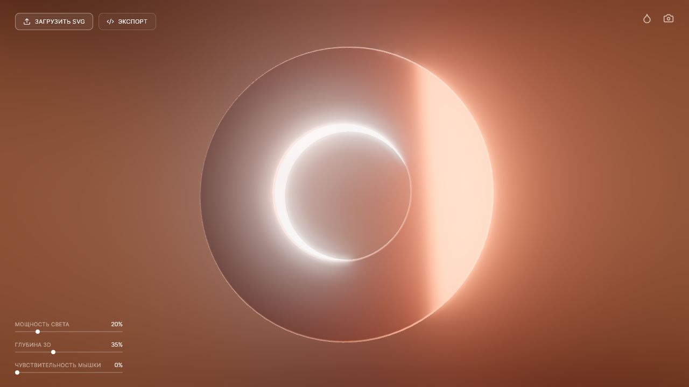

# Аудит 3D Vector Studio

Дата: 4 жовтня 2026 року. Джерело: https://maxshirko.me/3dstudio/.

Перевірено живий застосунок у настільному браузері, область перегляду 1280 × 720. Пройдено початкову сцену, HTML-експорт, зміну світла, запуск 4K-знімка, імпорт тестового SVG з отвором, зміну глибини, чутливості та кольору. Знімки нижче зроблено під час цієї перевірки. Код нашого прототипу не змінювався.

## Висновок

Це сильний референс для художньої подачі SVG у 3D: готова сцена одразу демонструє результат, а небагато налаштувань зберігають узгоджений вигляд. Найцінніший принцип для нашого продукту — спільно проєктувати матеріал, оточення для відбиттів, світло, фон і постобробку. Самого матеріалу «хром» недостатньо.

Водночас в оглянутому інтерфейсі немає повного набору засобів точного редактора сцени, потрібного за нашими вимогами. Це не доказ відсутності прихованих або майбутніх можливостей.

## Перевірений сценарій

1. **Початкова сцена — працює добре.** Об’ємний логотип відразу пояснює призначення продукту. Мінімум контролів залишає місце об’єкту. Підписи внизу дрібні й візуально малоконтрастні; числовий контраст не вимірювався.

   

2. **Експорт — функціонально зрозумілий після відкриття, назва неоднозначна.** Кнопка «ЭКСПОРТ» відкриває HTML EMBED із кодом, копіюванням та налаштуванням чутливості. Для користувача, який очікує PNG/JPG, це несподіваний результат. Зображення виводиться окремою кнопкою камери. Копіювання та розміщення embed на сторонньому сайті не перевірялися.

   

3. **Світло — видимий зворотний зв’язок, обмежений контроль.** Повзунок змінено з 50 до 20. Сцена реагує, але яскраві краї й bloom залишаються виразними. Для деяких форм це може приховувати деталі. Окремих налаштувань позиції джерела, експозиції чи bloom не знайдено.

   

4. **4K-знімок — завершення підтверджує інтерфейс, файл не перевірено.** Під час роботи кнопка блокувалася, статус показував `4K CAPTURE · AA 20/50`, потім `4K SCREENSHOT SAVED · AA ×50`. Автоматизація браузера не отримала подію завантаження, тому фактичні розміри, формат і якість файла незалежно не підтверджено. Це не підстава оголошувати завантаження несправним. Наведений знімок показує сцену після завершення; тимчасовий статус на ньому вже не видно.

   

5. **Імпорт і колір — успішно на простому SVG.** Завантажено наш синтетичний SVG кільця: отвір зберігся. Установлено глибину 35, чутливість 0 та колір `#c76831`. Об’єкт, відбиття й фон набули узгодженої теплої палітри. Це радше тональна гармонія, ніж підтверджена комплементарна схема. На внутрішньому краї сильне світіння зменшує читабельність форми. Успіх одного кільця не доводить підтримку складних SVG.

   

## Відповідність нашим вимогам

| Наша вимога | Що спостерігалося |
| --- | --- |
| SVG → об’ємна геометрія | Працює на тестовому кільці з отвором; є глибина |
| Скло, метал, хром і колір | Колір є; окремого вибору матеріалів не знайдено |
| Керовані світло, фаски, текстури | Є загальний повзунок світла; інших явних контролів не знайдено |
| Точне положення об’єкта й камери | Є реакція на мишу та чутливість; явних reset, паузи й числових кутів не знайдено |
| Узгоджений фон | Зміна кольору впливає на всю палітру |
| 16:9, 9:16, 4:3, 3:4, 1:1 | Вибору пропорцій не знайдено |
| JPG/PNG у 4K | Є команда 4K-знімка; вибору JPG/PNG не знайдено, файл не перевірено |
| Фізично коректне заломлення | Не підтверджено; показаний embed використовує растровий PBR і художні ефекти |

## Що видно в коді з HTML EMBED

Ці висновки стосуються саме коду, який застосунок показує користувачеві в експортному вікні. Вони не описують гарантовано всю внутрішню реалізацію редактора або сервер.

- Three.js 0.185.1, SVGLoader та ExtrudeGeometry; геометрія масштабується за bounding box. Є автоматичний підбір фасок із врахуванням отворів і складності форми та обчислення згладжених нормалей.
- MeshPhysicalMaterial для основної поверхні й боків. У зафіксованому початковому стані transmission дорівнює 0, metalness близько 0.9: блиск цього прикладу не є доказом скляного заломлення.
- Синтетичне оточення для відбиттів через PMREM і 12 прямокутних джерел світла. Видимий фон створюється окремим процедурним шейдером. Світло й оточення анімуються.
- AgX tone mapping, sRGB на виході, bloom, FXAA, віньєтка та художній flare. Flare оцінює умови появи відблиску евристично; це не фізичне трасування оптики.
- Адаптивні профілі змінюють pixel ratio, масштаб bloom і MSAA залежно від FPS. Рендер пропускається, коли документ прихований. Фактичний FPS у цій перевірці не вимірювався.
- Код завантажує модулі через esm.sh: експортований HTML має зовнішню мережеву залежність.

Тому візуальну привабливість тут варто оцінювати окремо від фізичної точності. Растровий PBR може дати гарний інтерактивний preview, але не підтверджує коректність каустик або складного заломлення.

## Доступність

Підтверджено читанням DOM:

- «Завантажити» та «Експорт» — елементи `div` без role і з tabIndex −1. Вони не мають стандартної семантики кнопки та звичайної доступності через Tab.
- Повзунки світла, глибини й чутливості не мають програмно пов’язаних label або aria-label, хоча візуальні підписи присутні.
- Кнопка камери не має aria-label або title; підказка з’являється візуально. Доступне ім’я слід перевірити й задати явно.
- Для поля кольору не знайдено змістовного пов’язаного підпису.

Рекомендовані виправлення: native button, пов’язані label, видимий focus, доступне ім’я камери, керування рухом. Повний прохід клавіатурою, screen reader, вимірювання контрасту та поведінка prefers-reduced-motion не перевірялися.

## Пріоритети для нашого прототипу

**P0 — якість базової сцени та керованість.** Додати узгоджене студійне оточення для відбиттів, освітлення і фон. Спочатку перевірити три стилі — скло, метал, хром — на логотипі, кільці й тонких деталях. Дати користувачу зафіксувати кадр, призупинити рух та скинути камеру. Не копіювати кількість джерел автоматично: обрати мінімальний набір за якістю й виміряною швидкодією.

**P1 — передбачувані налаштування та експорт.** Відокремити прості стилі від розширених параметрів. Назвати дію «Завантажити зображення», показати формат, пропорції й точні розміри перед запуском. HTML embed, якщо він колись знадобиться, має бути окремою дією. Bloom робити помірним і керованим.

**P1 — відповідність preview і фіналу.** Описувати оточення, світло та color pipeline явно й версіоновано, з узгодженими адаптерами Three.js і Cycles. Не змінювати tone mapping тільки в одному рендері та не створювати дві незалежні сцени, що лише приблизно схожі. Однакові параметри самі по собі не гарантують однаковий результат — потрібні збережені порівняльні рендери.

**P2 — плавність презентації.** Адаптивна якість корисна для preview; вона не повинна змінювати параметри фінального експорту. Автоматичний рух доречний як окремий режим презентації зі зрозумілою паузою.

Можливе доповнення архітектури: стиль як узгоджена композиція матеріалу, lighting rig, environment, backdrop і постобробки. Це пропозиція для наступної реалізації, а не новий контракт. Перед додаванням полів потрібно узгодити специфікації, JSON Schema, версіонування, adapters і fixtures відповідно до AGENTS.md. Тимчасову якість preview та UI-стан не слід автоматично включати у незмінний фінальний snapshot.

## Межі перевірки

Не перевірялися мобільний інтерфейс, весь діапазон SVG, захист імпорту, продуктивність на різних GPU, фактичний файл 4K, фізична точність світла, повний сторонній код і серверна архітектура. Це функціональний та візуальний аудит конкретного настільного сценарію, а не security review або benchmark.
